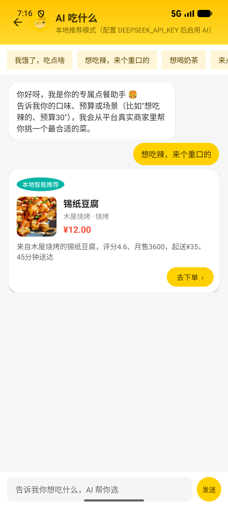

# 外卖平台（美团风格）Android 演示项目

一个仿美团外卖的两端一体 Android 项目：**顾客端 + 商家端 + AI 点餐助手**，使用 **Java + XML 布局**，数据为**本地 Mock 数据**（内存单例模拟后端），无需服务器即可运行，适合课程设计 / 毕业设计 / Android 学习。

- **10 家商家 × 30 道菜 = 300 个真实菜品**，覆盖麻辣烫、炸鸡、奶茶、拉面、披萨、沙县、烧烤、轻食等品类
- **67 张本地真实食物照片**（离线打包在 `assets/food/`，Glide 加载 + 圆角裁剪，无网络也能显示）
- **AI 点餐助手**：接入 DeepSeek API，问「吃什么」会基于平台真实商家/菜品推荐，并可直接跳转下单；未配置 Key 时自动降级为本地智能推荐

## 实机截图（Pixel 6 模拟器实拍）

### AI 点餐助手

| AI 推荐（真实店铺 + 真实菜品 + 一键下单） |
| --- |
|  |

### 入口与顾客端

| 入口页 | 首页 | 店铺点餐 |
| --- | --- | --- |
|  |  |  |

| 购物车 | 确认订单 | 订单列表 |
| --- | --- | --- |
|  |  |  |

### 个人中心与商家端

| 个人中心 | 商家工作台 | 商家订单管理 |
| --- | --- | --- |
|  |  |  |

## 数据规模

| 商家 | 品类 | 菜品数 | 主打 |
| --- | --- | --- | --- |
| 川香麻辣烫 | 麻辣烫 | 30 | 招牌麻辣烫 / 冒菜 |
| 肯德基 | 快餐 | 30 | 香辣鸡腿堡 / 全家桶 |
| 蜜雪冰城 | 奶茶 | 30 | 冰鲜柠檬水 / 珍珠奶茶 |
| 兰州拉面 | 面食 | 30 | 牛肉拉面 / 炒拉条 |
| 必胜客 | 披萨 | 30 | 超级至尊披萨 / 意面 |
| 沙县小吃 | 快餐 | 30 | 拌面 / 扁肉 |
| 一点点 | 奶茶 | 30 | 波霸奶茶 / 奶盖茶 |
| 黄焖鸡米饭 | 快餐 | 30 | 招牌黄焖鸡 |
| 木屋烧烤 | 烧烤 | 30 | 羊肉串 / 烤生蚝 |
| 轻食主义 | 轻食 | 30 | 鸡胸沙拉 / 低卡碗 |

菜品按所属分类自动挂载真实图片（`soup_*` / `chicken_*` / `drink_*` / `noodle_*` / `pizza_*` / `beef_*` / `salad_*` / `dessert_*` / `breakfast_*` / `rice_*`）。

## AI 点餐助手

### 能力
- 聊天式点餐，支持快捷问题胶囊（「我饿了，吃点啥」「想吃辣，来个重口的」「想喝奶茶」「预算 30 以内」）
- 回复中直接给出**推荐卡片**：菜品大图、菜名、所属**真实商家**、价格、评分/月售/起送价/配送时长，以及推荐理由
- 卡片右下角「去下单」→ 直达该店铺详情页，菜品已在列表中，可直接加购结算
- 强约束防幻觉：模型只能返回菜单里的菜品，返回结果还会在本地二次校验商家/菜品是否真实存在，不合法则直接降级

### 接入真实 DeepSeek API
1. 打开项目根目录的 `local.properties`（该文件已被 `.gitignore` 排除，不会泄露）
2. 追加一行：
   ```properties
   DEEPSEEK_API_KEY=sk-你的真实Key
   ```
3. 重新 Sync / Run，App 顶部副标题会从「本地推荐模式」变为「DeepSeek 驱动 · 基于平台真实商家推荐」
4. 生效原理：`app/build.gradle` 读取该属性 → `BuildConfig.DEEPSEEK_API_KEY` 注入 → `DeepSeekClient` 以 OpenAI 兼容格式请求 `https://api.deepseek.com/chat/completions`（`model=deepseek-chat`，`temperature=0.8`，`max_tokens=400`），system prompt 中注入全部 300 道菜的菜单上下文，要求模型只从菜单挑选、并按约定 JSON 单行返回

### 降级策略
未配置 Key 或请求失败（超时 / 网络异常 / 返回格式异常）时，自动降级到 `LocalAdvisor` 本地推荐：按口味关键词（辣 / 甜 / 清淡 / 奶茶 / 面 / 烧烤 / 快餐…）、预算区间、商家评分与月售加权打分，输出同样结构的推荐卡片。因此**无 Key 也能完整演示**。

> 卡片右上角标签会显示当前模式：「DeepSeek 智能推荐」或「本地智能推荐」。

## 技术栈

| 项目 | 说明 |
| --- | --- |
| 语言 | Java |
| UI | XML 布局（View 体系），Material Components，ConstraintLayout |
| 图片 | Glide 4.16.0（`assets/food/` 本地图片，`RoundedCorners` 裁剪） |
| 网络 | `HttpURLConnection` + 子线程回调（无第三方网络库） |
| 架构 | 单 Activity 多入口，`DataStore` 内存单例模拟后端 |
| 构建 | Gradle 9.5.0 + Android Gradle Plugin 8.11.0 |
| SDK | compileSdk 37 / minSdk 24 / targetSdk 37，JDK 17+ |

## 项目结构（标准 Android 工程）

```
MeituanDelivery/
├── app/src/main/                     # 关键代码都在 src 下
│   ├── AndroidManifest.xml
│   ├── assets/food/                  # 67 张真实食物图（离线可用）
│   ├── java/com/example/meituan/
│   │   ├── MainActivity.java         # 角色选择入口
│   │   ├── model/                    # User / Restaurant / Dish / Order / Address / Coupon / Review / ChatMessage
│   │   ├── data/                     # MockData（10 店 × 30 菜）+ DataStore（内存仓库，模拟后端）
│   │   ├── util/                     # UiKit / Images（Glide）/ DeepSeekClient（AI）/ LocalAdvisor（降级推荐）
│   │   ├── customer/                 # 顾客端：首页、店铺、购物车、下单、订单、个人中心、AiChatActivity
│   │   └── merchant/                 # 商家端：工作台、订单管理、菜品管理、营业设置
│   └── res/
│       ├── layout/                   # 全部页面布局（含 AI 聊天页与推荐卡片）
│       ├── drawable/                 # 圆角卡片 / 胶囊 / 渐变蒙版 / 图标
│       ├── color/                    # 状态色选择器
│       ├── values/                   # 配色 / 主题 / 文案
│       └── menu/                     # 底部导航菜单
├── docs/screenshots/                 # 实机截图（README 引用）
├── tools/                            # 图片批量抓取与代码回填脚本（仅开发期使用）
├── gradle/wrapper/                   # Gradle Wrapper
├── build.gradle / settings.gradle    # 构建配置（已配置国内镜像）
└── local.properties                  # 本机 SDK 路径 + DeepSeek Key（不入库）
```

## 如何运行

1. 打开 **Android Studio**。
2. 选择 **File → Open**，选中本项目根目录 `MeituanDelivery`。
3. 等待 Gradle 同步完成（已配置国内镜像源，下载 Gradle 与依赖更快）。
4. 连接真机或启动模拟器（API 24+），点击 **Run ▶** 运行。
5. 需要 AI 推荐时按上文配置 `DEEPSEEK_API_KEY`（可选）。

> 已配置镜像源：Gradle 发行版走华为云，依赖仓库走阿里云，避免国内网络超时。
> 命令行编译需指定 JDK 17+（本项目用 Android Studio 自带 JBR）：
> `JAVA_HOME="D:/android studio/jbr" ./gradlew assembleDebug`

## 功能清单

### 顾客端
- 首页：渐变头图 + 搜索框、AI 点餐入口卡片、分类筛选胶囊、店铺卡片列表（真实头图 / 评分 / 月售 / 配送费 / 时长 / 距离 / 公告）
- 店铺详情：顶部大图 + 渐变蒙版、左侧分类（选中黄条）+ 右侧菜品（大图、规格、加减购物车）、起送价校验
- 购物车：增删菜品、清空、合计结算
- 确认下单：选择收货地址、选择优惠券（满减门槛）、填写备注、模拟支付
- 订单：订单列表（店铺缩略图 + 状态胶囊）、订单详情、取消订单、模拟送达、去评价
- 个人中心：地址管理（增删 / 设默认）、优惠券、我的评价、退出登录
- AI 点餐：自然语言选餐 → 真实商家真实菜品推荐卡 → 一键跳转下单

### 商家端
- 店铺概览：营业状态（颜色随状态切换）、今日订单数
- 订单管理：接单 / 拒绝 / 出餐
- 菜品管理：上架 / 下架（缩略图 + 分类 + 价格）
- 营业设置：开关营业状态、查看营业信息

## 订单状态流转

```
顾客下单（待接单）
   → 商家接单（备餐中）
   → 商家出餐（配送中）
   → 顾客模拟送达（待评价）
   → 顾客评价（已完成）
   （待接单阶段可被顾客取消 / 商家拒绝）
```

> 本项目为演示性质，去掉了骑手端，配送环节由「商家出餐 → 配送中 → 顾客端『模拟送达』」模拟完成。

## 设计规范

- 品牌色：美团黄 `#FFD100` / 美团青 `#00B5A5`，价格统一橙红 `#FF4B33`
- 状态栏与黄色头部一体化，深色图标（`windowLightStatusBar=true`）
- 卡片统一 14dp 圆角、白底无描边，主按钮为黄底深字胶囊，次按钮浅灰胶囊
- 图片统一圆角 + `centerCrop`，头图叠加底部深色渐变蒙版保证文字可读
- 金额统一保留两位小数

## 图片来源

`app/src/main/assets/food/` 下的食物照片来自公开免费图库 **TheMealDB / TheCocktailDB**，仅用于学习与演示；`tools/download_images.py` 记录了抓取与命名规则，`tools/apply_images.py` 用于把图片名批量回填到菜品数据。
