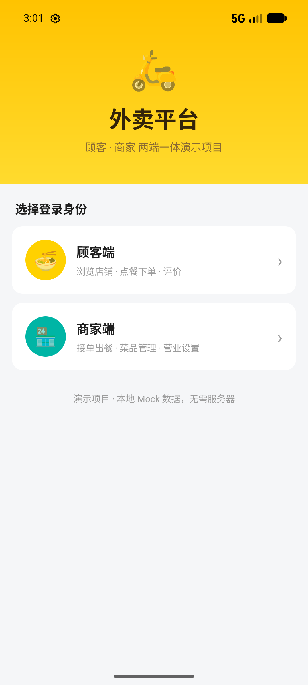
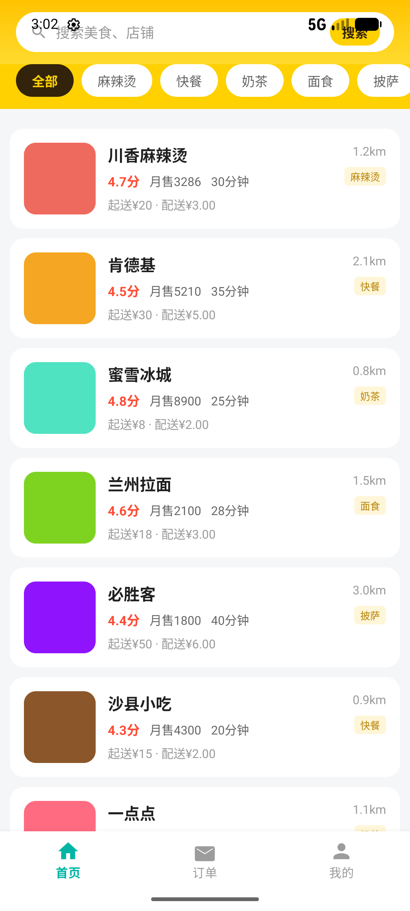
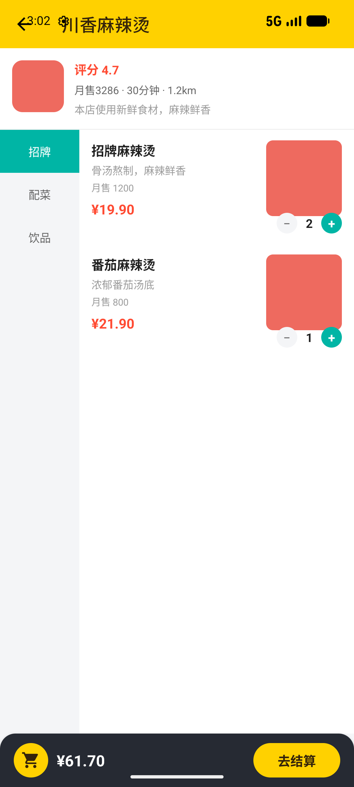
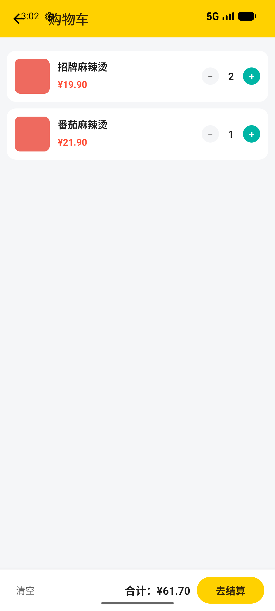
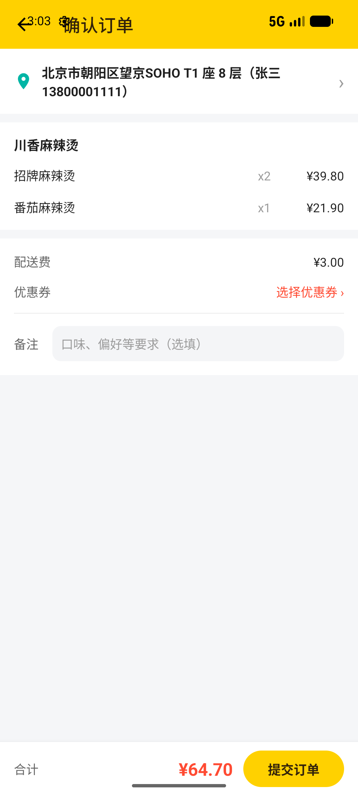
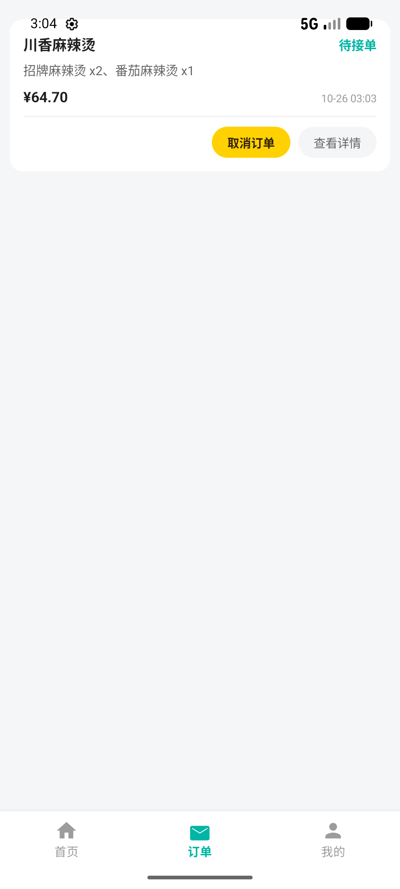
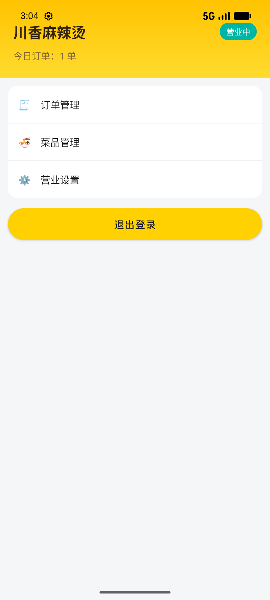
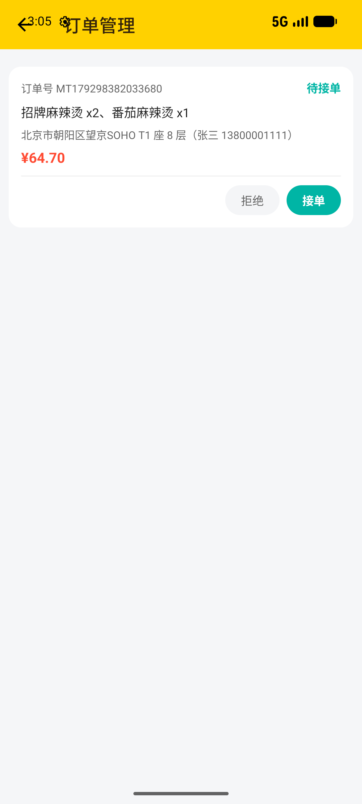

# 外卖平台（美团风格）Android 演示项目

一个仿美团外卖的两端一体 Android 项目：**顾客端 + 商家端**，使用 **Java + XML 布局**，数据全部采用**本地 Mock 数据**（内存单例模拟后端），无需服务器即可运行，适合课程设计 / 毕业设计 / Android 学习。

## 实机截图（Pixel 6 模拟器实拍）

### 入口与顾客端

| 入口页 | 首页 | 店铺点餐 |
| --- | --- | --- |
|  |  |  |

| 购物车 | 确认订单 | 订单列表 |
| --- | --- | --- |
|  |  |  |

### 个人中心与商家端

| 个人中心 | 商家工作台 | 商家订单管理 |
| --- | --- | --- |
|  |  |  |

## 技术栈

| 项目 | 说明 |
| --- | --- |
| 语言 | Java |
| UI | XML 布局（View 体系），Material Components |
| 架构 | 单 Activity 多端分包，`DataStore` 单例模拟后端 |
| 构建 | Gradle 9.5.0 + Android Gradle Plugin 8.11.0 |
| SDK | compileSdk 37 / minSdk 24 / targetSdk 37，JDK 17+ |

## 项目结构（标准 Android 工程）

```
MeituanDelivery/
├── app/src/main/                    # 关键代码都在 src 下
│   ├── AndroidManifest.xml
│   ├── java/com/example/meituan/
│   │   ├── MainActivity.java        # 角色选择入口
│   │   ├── model/                   # 数据模型（User/Restaurant/Dish/Order/Address/Coupon/Review）
│   │   ├── data/                    # MockData（假数据）+ DataStore（内存仓库，模拟后端）
│   │   ├── util/                    # UiKit（动态圆角色块）
│   │   ├── customer/                # 顾客端（Fragment + Activity + Adapter）
│   │   └── merchant/                # 商家端
│   └── res/
│       ├── layout/                  # 全部页面布局
│       ├── drawable/                # 圆角卡片 / 胶囊按钮 / 图标
│       ├── color/                   # 状态色选择器
│       ├── values/                  # 配色 / 主题 / 文案
│       └── menu/                    # 底部导航菜单
├── gradle/wrapper/                  # Gradle Wrapper
├── build.gradle / settings.gradle   # 构建配置（已配置国内镜像）
└── local.properties                 # 本机 SDK 路径（不入库）
```

## 如何运行

1. 打开 **Android Studio**。
2. 选择 **File → Open**，选中本项目根目录 `MeituanDelivery`。
3. 等待 Gradle 同步完成（已配置国内镜像源，下载 Gradle 与依赖更快）。
4. 连接真机或启动模拟器（API 24+），点击 **Run ▶** 运行。

> 已配置镜像源：Gradle 发行版走华为云，依赖仓库走阿里云，避免国内网络超时。
> 本机 SDK 位于 `D:\android.studio.sdk`（已在 `local.properties` 中指定）。

## 功能清单

### 顾客端
- 首页：搜索框、分类筛选胶囊、店铺列表（评分 / 月售 / 配送费 / 距离 / 公告）
- 店铺详情：左侧分类 + 右侧菜品，加减购物车，起送价校验
- 购物车：增删菜品、清空、合计结算
- 确认下单：选择收货地址、选择优惠券（满减门槛）、填写备注、模拟支付
- 订单：订单列表、订单详情、取消订单、模拟送达（列表 / 详情均可）、去评价
- 个人中心：地址管理（增删 / 设默认）、优惠券、我的评价、退出登录

### 商家端
- 店铺概览：营业状态（颜色随状态切换）、今日订单数
- 订单管理：接单 / 拒绝 / 出餐
- 菜品管理：上架 / 下架
- 营业设置：开关营业状态、查看营业信息

## 订单状态流转

```
顾客下单（待接单）
   → 商家接单（备餐中）
   → 商家出餐（配送中）
   → 顾客模拟送达（待评价）
   → 顾客评价（已完成）
   （待接单阶段可被顾客取消 / 商家拒绝）
```

> 本项目为演示性质，去掉了骑手端，配送环节由「商家出餐 → 配送中 → 顾客端『模拟送达』」模拟完成。

## 设计规范

- 品牌色：美团黄 `#FFD100` / 美团青 `#00B5A5`，价格统一橙红 `#FF4B33`
- 状态栏与黄色头部一体化，深色图标（`windowLightStatusBar=true`）
- 卡片统一 14dp 圆角、白底无描边，主按钮为黄底深字胶囊，次按钮浅灰胶囊
- 金额统一保留两位小数
